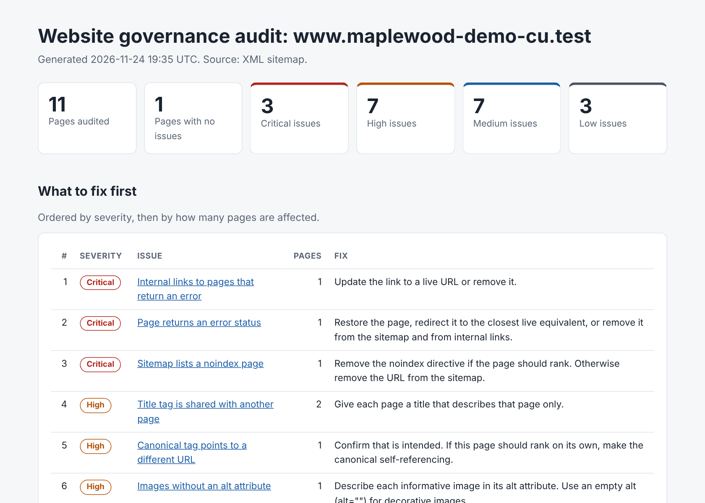

# Website Governance Audit

A command line tool that audits a website from its XML sitemap and returns a prioritized fix list. It runs 29 checks across indexation, metadata, accessibility, plain language, structured data, and internal links, then writes an HTML report, two CSV files, and a SQLite database you can query.



See the full sample: [report.md](examples/demo-report/report.md) (renders on GitHub), plus [issues.csv](examples/demo-report/issues.csv) and [pages.csv](examples/demo-report/pages.csv).

## What problem does this solve?

The first pass of a website audit is the same every time: is every page reachable, indexable, labeled, readable, and linked? Doing that by hand across a few hundred pages takes days and the result lives in someone's spreadsheet. This tool does the first pass in minutes, the same way every run, and says what to fix first and why.

It is built for sites where mistakes are expensive: financial services, healthcare, legal, and government. That is why it checks reading level and accessibility basics alongside the usual search checks.

## What does it check?

| Category | Checks | Examples |
| --- | ---: | --- |
| Indexation | 8 | Error pages in the sitemap, noindex pages in the sitemap, redirect chains, robots.txt conflicts, canonical tags that point elsewhere |
| Metadata | 8 | Missing or duplicate titles and descriptions, missing or multiple H1s, length guidelines |
| Accessibility | 5 | Missing page language (WCAG 3.1.1), images without alt attributes (WCAG 1.1.1), empty or generic link text (WCAG 2.4.4), skipped heading levels |
| Content | 2 | Reading level above a target grade (Flesch-Kincaid), thin pages |
| Structured data | 3 | JSON-LD that does not parse, missing expected properties, pages with no markup |
| Links | 3 | Broken internal links, internal links that redirect, orphan pages |

Every check has a severity, a plain explanation of why it matters, and a fix. All of that lives in one registry in [`checks.py`](src/webaudit/checks.py), and the reports are generated from it.

## How do I run it?

Requires Python 3.10 or newer.

```bash
git clone https://github.com/callanspyfer/website-governance-audit.git
cd website-governance-audit
pip install -e .
```

Try it on the included demo site (no network needed):

```bash
webaudit --dir examples/demo-site --base-url https://www.maplewood-demo-cu.test --out audit-report
```

```
11 pages audited, 20 issues (3 critical, 7 high, 7 medium, 3 low)
Report: audit-report/report.html
```

Run it on a live site:

```bash
webaudit --sitemap https://www.example.org/sitemap.xml --out audit-report
```

| Option | What it does |
| --- | --- |
| `--sitemap URL` | Audit every URL in an XML sitemap or sitemap index |
| `--urls FILE` | Audit a list of URLs, one per line |
| `--dir FOLDER` | Audit a folder of HTML files offline (a static build or an export) |
| `--max-pages N` | Stop after N pages (default 500) |
| `--delay SECONDS` | Wait between requests (default 1.0) |
| `--grade-target N` | Flag pages that read above this grade level (default 8) |
| `--fail-on SEVERITY` | Exit with status 1 if issues at that severity or worse exist, so the audit can gate a deploy in CI |

Against a live site the tool obeys robots.txt, sends a user agent that identifies itself, and waits between requests.

## What do I get back?

| File | Contents |
| --- | --- |
| `report.html` | Self-contained report: summary, prioritized fix list, findings by check, reading level by page |
| `report.md` | The same report in Markdown, for a ticket, a wiki, or a pull request |
| `issues.csv` | One row per issue: severity, category, check, URL, detail, fix |
| `pages.csv` | One row per page: status, title, description, canonical, H1, word count, reading grade, link and image counts, structured data types |
| `audit.sqlite` | The same data as three tables: `pages`, `issues`, `checks` |

## How do I analyze the results with SQL?

The [`queries/`](queries) folder has five queries that run against `audit.sqlite`:

| Query | Question it answers |
| --- | --- |
| [`01_issues_by_check.sql`](queries/01_issues_by_check.sql) | Which problems are most serious and most widespread? |
| [`02_worst_pages.sql`](queries/02_worst_pages.sql) | Which pages need the most work? |
| [`03_template_level_issues.sql`](queries/03_template_level_issues.sql) | Which issues are template problems that can be fixed once? |
| [`04_reading_level_by_section.sql`](queries/04_reading_level_by_section.sql) | Which site section is hardest to read? |
| [`05_indexable_pages_scorecard.sql`](queries/05_indexable_pages_scorecard.sql) | Does each indexable page have the basics? |

```bash
sqlite3 -header -column audit-report/audit.sqlite < queries/04_reading_level_by_section.sql
```

Result on the demo site:

```
section     pages_scored  avg_grade  hardest_page_grade  avg_words_per_sentence  total_words
/loans/     2             10.2       19.5                15.9                    336
/checking/  2             3.3        3.4                 7.8                     272
/savings/   1             3.1        3.1                 8.3                     124
/about/     1             2.6        2.6                 9.0                     126
/           1             2.4        2.4                 9.3                     167
/blog/      1             1.6        1.6                 8.7                     173
```

## How is severity decided?

| Severity | Meaning | Example |
| --- | --- | --- |
| Critical | A page or link is broken, or the site is giving search engines contradictory instructions | The sitemap lists a page that is set to noindex |
| High | The page works but a core signal is wrong or a WCAG Level A basic is missing | Two pages share one title, or an image has no alt attribute |
| Medium | A real gap that weakens the page | No meta description, or text that reads at a college level |
| Low | A guideline, worth fixing in bulk | A title longer than 60 characters |

The fix list is sorted by severity, then by the number of pages affected.

## Design decisions

- **One registry for every check.** Severity, explanation, and fix are defined once and reused in the HTML report, the Markdown report, the CSV, and the database. The rule and its documentation cannot drift apart.
- **Headings and navigation are left out of the reading score.** Counting a heading as a short sentence makes every page look easier to read than its paragraphs are.
- **An empty alt attribute is not an error.** `alt=""` is correct for decorative images. Only a missing attribute is flagged.
- **A noindex page is only a problem when the sitemap lists it.** Noindex on its own is a valid choice. The conflict is the finding.
- **Internal links are checked even when the target is not in the sitemap.** That is how the audit finds links to deleted pages.
- **The demo site is the regression test.** It has one planted problem for almost every check, and a test pins the exact list of findings. A change that adds a false positive or loses a real finding fails the build.

## What are the limits?

- It reads the HTML the server returns. It does not run JavaScript, so content rendered in the browser is not seen.
- The reading grade is an estimate for English text. Syllables are counted with spelling rules, not a pronunciation dictionary.
- The accessibility checks cover five basics that can be tested from markup. They are a first screen, not a WCAG conformance audit, and they do not replace testing with assistive technology.
- The structured data check looks for properties this audit expects on common types. It is not a copy of any search engine's rich result requirements.
- Pages behind a login are out of scope.

## Project layout

```
src/webaudit/
  fetch.py         page sources: live site (sitemap or URL list) and local folder
  parse.py         HTML to page facts
  readability.py   Flesch-Kincaid grade
  checks.py        the check registry and the rules
  audit.py         orchestration
  report.py        CSV, SQLite, Markdown, HTML
  cli.py           command line
queries/           SQL for audit.sqlite
examples/          demo site (fictional credit union) and its report
tests/             58 tests
```

## Tests

```bash
pip install -e ".[dev]"
pytest
```

The suite covers the syllable rules against known words, the grade formula against a hand calculation, every page-level check firing alone, the full demo site run, live-site behavior (sitemap index, redirects, robots.txt) against a localhost server, and every SQL query.

## About

Built by Callan Pyfer. Eight years in SEO, analytics, and web content for financial services, healthcare, and government sites.

- Site: [callanpyfer.com](https://callanpyfer.com/)
- LinkedIn: [linkedin.com/in/callan-pyfer](https://www.linkedin.com/in/callan-pyfer)

The check list, severity model, and thresholds follow the audit sequence I use on live sites: fix what blocks indexing first, then metadata, then content quality.

The demo site, Maplewood Demo Credit Union, is fictional. Its rates and products are made up for testing.

## License

[MIT](LICENSE)
